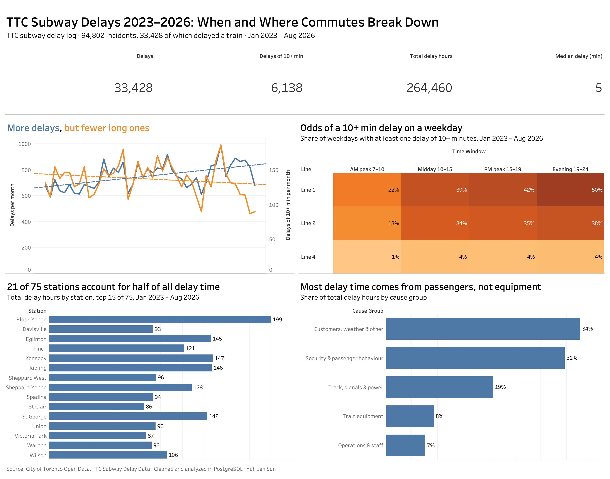

# TTC Subway Delays 2023–2026 (SQL + Tableau)

If you ride the TTC subway to work, how likely are you to hit a long delay, and where and why do they happen? I took the City of Toronto's subway delay log from January 2023 to August 2026, cleaned it in PostgreSQL, and built a Tableau dashboard to answer that.



**Tools:** PostgreSQL (CTEs, window functions, regex, lookup tables), Tableau
**Data:** [TTC Subway Delay Data](https://open.toronto.ca/dataset/ttc-subway-delay-data/), City of Toronto Open Data. 94,891 records across three files.

## What I found

**Only about a third of logged incidents actually delay a train.** Of 94,802 incidents, 33,428 (35%) held up service. The median delay is 5 minutes and 90% are 14 minutes or less, but together they add up to about 4,400 hours.

**Delays are becoming more frequent but shorter.** Comparing January to August of each year (2026 data stops in August), delays went up 22% from 2023 to 2026, while delays of 10 minutes or more went down 16%.

**Line 1 is the least reliable, even per station.** Over the period, Line 1 had 498 delays per station, Line 2 had 418, and Line 4 had 240.

**The morning commute is the safest part of the day.** On Line 1, 22% of weekday mornings (7–10am) had at least one delay of 10+ minutes. That rises to 42% for the afternoon peak (3–7pm) and 50% in the evening. Line 2 follows the same pattern at slightly lower levels. Line 4 stays under 5% all day.

**A small set of stations carries most of the delay.** Bloor-Yonge alone accounts for about 200 hours. 21 of the 75 stations make up half of all delay time, and most of the top 15 are interchanges (Bloor-Yonge, St George, Sheppard-Yonge, Spadina) or terminals (Kennedy, Kipling, Finch).

**Most delay time isn't caused by trains breaking down.** Passenger, security and other non-equipment causes account for about 65% of delay minutes. Train equipment is 8%. The biggest single cause is disorderly passengers (4,404 delays, about 500 hours). A train hitting a person happened 108 times but averaged 77 minutes each.

## How I cleaned the data

The raw files needed a lot of work before any of these numbers could be trusted. Each step is one SQL file, run in order.

| Step | File | What it does | Result |
|---|---|---|---|
| 1 | `01_load_raw.sql` | Load all files as text, so nothing is silently converted | 94,891 rows |
| 2 | `02_combine.sql` | Stack the 2023, 2024 and 2025+ files with `UNION ALL` and set data types | 94,891 rows |
| 3 | `03_dedupe.sql` | Remove exact duplicates with `ROW_NUMBER()` | 89 removed, 94,802 left |
| 4 | `04_clean_line.sql` | Map ~50 spellings of the line (`YU`, `YU / BD`, `BD LINE 2`...) to Lines 1–4 with `CASE` | 6 groups |
| 5 | `05_stations.sql` | Load the official list of 75 stations | 75 stations |
| 6 | `06_clean_station.sql` | Match 1,674 station spellings to the 75 stations | 96% of rows, 99% of delay minutes matched |
| 7 | `07_codes_and_final_table.sql` | Merge the old and new delay code tables, fix broken characters, build the final table | `analytics.delays` |
| 8 | `08_analysis.sql` | Answer the business questions | |
| 9 | `09_export_for_tableau.sql` | Export two CSVs for Tableau | |

Some decisions worth explaining:

- **UNION ALL, not UNION.** `UNION` would have dropped the 89 duplicate rows without saying so. I wanted to see and count them, so I removed them in their own step.
- **What counts as a duplicate.** Two rows that match on every field describing the incident. If I had only used date, time and station, 334 rows would have been removed, including real incidents with different causes in the same minute.
- **Station matching.** Station names were typed by hand and cut off at 22 characters, so the same station appears as `ST GEORGE YUS STATION`, `ST. GEORGE STATION`, `ST.GEORGE TO ST.ANDREW` and many more. I generated a pattern from each official station name, added 23 exceptions for renamed stations (Dundas → TMU, Eglinton West → Cedarvale), abbreviations (VMC) and interchanges recorded under one line's name, and kept the longest match when a name matched more than one pattern (so `LAWRENCE EAST` doesn't become Lawrence). Yards and whole-line entries are kept separate so Wilson Yard isn't counted as Wilson station.
- **Rows that list two lines.** 1,329 incidents are tagged with both Line 1 and Line 2, and all of them have 0 delay minutes. They're system notices, so I kept them as their own group instead of splitting them across lines.
- **Unknown codes.** 1.5% of records use codes that aren't in either code table (mostly `SUL`). I labelled them as unknown rather than guessing. They're 0.2% of delay minutes.
- **A wrong weekday in the source.** All 63 records on April 26, 2026 say Saturday, but that date was a Sunday. The final table recalculates the weekday from the date.

Exploratory queries I ran along the way are in [`sql/explore.sql`](sql/explore.sql).

## Running it

You need PostgreSQL and the files in `data/`. From the project folder:

```bash
createdb ttc
for f in sql/0*.sql; do psql -d ttc -f "$f"; done
```

Step 9 writes the Tableau files to `data/tableau/`. The dashboard is `dashboard/ttc_subway_delays.twbx` and opens in Tableau Desktop, Tableau Reader or Tableau Public.

## Limitations

- **No ridership data.** "Delays per station" adjusts for line length, but not for how many people use each station. Busy stations probably have more incidents partly because they have more people.
- **The time windows aren't the same length** (3, 5, 4 and 5 hours), so longer windows have more chances for a delay. Looking at long delays per hour gives the same answer, though: about 160 an hour in the morning peak and about 260 in the afternoon peak.
- **Delay minutes are what the TTC recorded for each incident**, not the total impact on riders. One incident can affect many trains.
- **0.5% of records couldn't be matched to a station** (emergency exits, office buildings, vague entries like "various locations").
- **Line 3** closed in July 2023, so it's left out of the line comparisons.

## Files

```text
sql/                  SQL steps 01–09, plus explore.sql
data/raw/             source files from Toronto Open Data (Excel files converted to CSV)
data/reference/       official TTC station list
data/tableau/         CSV files used by the dashboard
dashboard/            Tableau packaged workbook
images/               dashboard screenshot
```

## Author

Yuh Jen Sun · Toronto · [LinkedIn](https://www.linkedin.com/in/yuh-jen-sun-3120b83b1)
